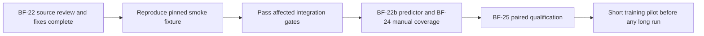

# BF-22 bounded independent review — 2026-10-11

## Scope and provenance

Checkout D:/Projects/ti4-engine-rs, branch wp/base-factions, HEAD a8ed02533f3b2c1cc3bb38f49b280b5ba1b7e12a. Review pinned historical diff `git diff ba4f58f9...2abdf938`: commits 37dc3c54 (wide consumer plumbing), 60229ef7 (research waiver termination), 2abdf938 (capacity growth/OOV migration). Later predictor version 8 is a separate BF-22b package. Pinned specification: `git show 2abdf938:plans/evidence/BF-22-WIDE-POLICY.md`, BF-22 plan, and AGENTS.md accuracy/review rules. Existing plans are the local specification ledger; no new tracker configuration was installed.

Original author Claude Opus 5.5 was not the reviewer. Independent Standards: /root/training_review (gpt-5.6-sol); Spec: /root/continuation_checklist (gpt-6-luna). Coordinator performed separate frontier source review of schema migration, compatibility, deterministic roster/census behavior, and the research-loop legality/termination change. Historical source review and current dirty-source tests have distinct provenance; tests below do not claim to reproduce the historical tree exactly.

## Standards

Initial findings: three documented accuracy violations and one possible duplication smell.

1. Census counted failed games yet could publish migration input and exit successfully; the broad behavior existed before the diff, but the new wide-roster failure path inherited it. Fixed: output selection refuses any game error before names publication, through the existing exit-2 refusal path. Complete-census threshold and canonical ordering are retained. Regression covers failed nonempty/empty census and successful ordering/filtering.
2. Census documentation incorrectly claimed zero rows preserve original-six scores. Fixed: vocabulary-absent names can occur in either roster; OOV-copy migration preserves former fallback contributions mathematically, with floating-point accumulation caveat.
3. BF-22 opening/table still described capacity migration as blocked after recording its implementation. Fixed both; historical measurements retained.
4. Possible duplicated declined-waiver filtering in primary/paid research. Rejected extraction: the short invariant repeats in materially different payment/mutation flows; a helper adds navigation without a useful boundary. Independent reviewer accepted this disposition.

Independent re-review found no unresolved scoped source/test issue; a final contradictory table cell was identified and corrected. Integration infrastructure failure below remains an acceptance blocker, not a waived standards finding.

## Spec

Initial findings: inaccurate zero-row preservation claim and missing separate-critic migration coverage. Applicable spec: "No silent reinterpretation" and "pads W1, and a separate critic's input, with zero rows, atomically." No other missing bounded BF-22 requirement or unjustified scope expansion found.

Added a deterministic separate-critic test with nonzero V(s): value and old rows are preserved through growth; new rows are zero; OOV fallback row remapping preserves value; malformed critic growth refuses before changing policy input/capacity; invalid multi-pair copy refuses before changing critic target. Both smaller reviewers independently checked the revised test. Existing tests cover successful policy-row remapping and vocabulary index/capacity invariants.

Frontier source assessment: append uses a validated clone before assignment, stable key-ordered appends preserve old IDs/OOV columns; growth builds policy and critic tables before replacement; migration copies old OOV sources to new destinations and records initialization/capacity provenance, preserves source checkpoint, and reloads destination through ordinary loader. Roster opt-in preserves fixed caller order and dedicated seating RNG domain; indexed Rayon harvest preserves merge order. Research attempts remove each declined waiver-only technology for that attempt, so both loops progress or terminate without another payment for the declined attempt. No additional critical defect identified in this bounded review. Bitwise wide-game equivalence is explicitly not claimed: existing evidence records accumulation-rounding differences.

## Checks actually run

All commands used pinned CPU libtorch `out/libtorch-2.9.1-cpu` and its DLL directory, OMP_NUM_THREADS=1, MKL_NUM_THREADS=1. Cargo jobs=8 and Rust test threads=8 bound compilation/test concurrency; no GPU/training job.

- `cargo test -j8 -p ti4-engine -p ti4-policy -p ti4-training -p ti4-mlp --lib -- --test-threads=8`: exit 0; engine 2812 passed/1 ignored; mlp 110 passed; policy 300 passed; training 163 passed. Total 3385 passed, zero failures, one ignored. Log `out/logs/check-bf22-review-libs-20261011.log`.
- After fixes, `cargo test -j8 -p ti4-mlp --lib --example vocab_census -- --test-threads=8`: exit 0; 111 library tests plus 1 census example test passed, zero failures. Log `out/logs/check-bf22-review-fixes-20261011.log`. Includes nonzero critic migration regression.
- `cargo test --no-fail-fast -j8 -p ti4-engine -p ti4-policy -p ti4-training -p ti4-mlp --test '*' -- --test-threads=8`: exit 101; 14 passed, 1 failed, 1 ignored. Log `out/logs/check-bf22-review-integration-20261011.log`.
- Scoped `git diff --check -- crates/ti4-mlp/src/lib.rs crates/ti4-mlp/examples/vocab_census.rs`: exit 0 after removing unrelated formatter churn.

The integration failure is `ti4-mlp::smoke_refusals::a_pool_without_an_allowed_manifest_role_is_refused`. The subprocess exits 2 as required but fails the expected pool-rejection assertion because it first refuses `out/vocabulary/current.json names no valid generation`. The test assumes an accepted local vocabulary generation and invokes an existing mlp_smoke binary. Source inspection confirms vocabulary verification precedes pool verification; the current pointer names fa3d6f945988cc9f210fffafff115422c9bf883c077ae8aac8aaf483d1ec41fc, whose acceptance fails. This reproduces the documented environmental blocker; it is not a pool-gate pass. No retries, fixture weakening, or retained-artifact overwrite were performed.

## Disposition and next step

Bounded independent source review and concrete findings are resolved. BF-22 acceptance remains OPEN because affected integration tests are not all green; no full-workspace or BF-25 exit claim. Next dependency-ready work: make the smoke refusal fixture reproducible from its pinned accepted vocabulary contract without overwriting retained artifacts, then rerun that target. BF-22b version-8/ground-predictor review, BF-24 manual producer/subtype inventory, and BF-25 paired schedule remain separate packages. Training remains stopped by operator.

Task-owned source changes: crates/ti4-mlp/examples/vocab_census.rs; one regression test in crates/ti4-mlp/src/lib.rs. Task-owned docs: this evidence and scoped current-state/BF-22 clarification. Existing dirty engine/training/UI changes, all checkpoints, runs, and other untracked files are preserved. Nothing staged, committed, or pushed in this review.

## Follow-up: reproducible smoke fixture and workspace result

The earlier failed run is retained above. A fresh build established the precise cause: the committed checkpoint-473312 vocabulary has registry version 10, while the strict training loader requires 11. The provenance-name presence check did not reject its UNRECOVERED values; do not attribute this failure to missing provenance fields.

`smoke_refusals::refuses_an_unallowed_pool_with_exit_two` now supplies the committed checkpoint-473312 slots explicitly rather than a machine-local training-generation pointer. SHA-256: FA3D6F945988CC9F210FFFAFFF115422C9BF883C077AE8AAC8AAF483D1EC41FC. `mlp_smoke` validates the retained historical vocabulary with the existing read-only inference loader, preserves its column layout, and clones that validated vocabulary for its consumers. Exact fixture hash validation remains before parsing. The training loader and default training-generation pointer remain strict; no artifact was overwritten or relabelled. Independent Luna re-review accepted this bounded change.

Fresh rebuild and reruns: smoke refusals 2 passed/0 failed (`check-smoke-fixture-refusals2-20261011.log`); explicit pinned-fixture one-round smoke exit 0, 183 steps, 165 resolved choices, 219 model decisions/0 fallback (`check-smoke-fixture-game-20261011.log`). This checks inference and legality plumbing, not vocabulary coverage qualification. Affected integration rerun: 15 passed/0 failed/1 ignored, exit 0 (`check-bf22-integration-fixed-20261011.log`). The earlier smoke integration blocker is resolved.

Full workspace: `cargo test --workspace --no-fail-fast -j8 -- --test-threads=8`, CPU libtorch, OMP/MKL 1; log `out/logs/check-base-factions-workspace-20261011.log`. Exit 101: 4061 passed/1 failed/6 ignored. Sole failed target: ti4-review semantic_golden, `the_reviewers_default_path_matches_the_frozen_pre_r02_golden`. Frame 7 retained its phase/active seat/decision/engine-step values, but event count changed 1 -> 2 and structured count 0 -> 1, with corresponding digest differences. This is the previously recorded reviewer golden issue, not a passing workspace gate. No golden was regenerated. This full run predates the subsequent BF-22b repair/context fixes; current qualification must use their later checks too.

BF-22 bounded findings and affected integration checks are resolved; workstream exit remains open on separate BF-22b/BF-24/BF-25 obligations and the workspace golden disposition. See [BF-22b review](BF-22B-REVIEW-2026-10-11.md). Training remains stopped. Nothing staged, committed, or pushed.