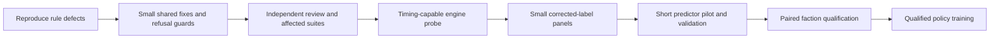

# BF-22b independent review and correctness fixes — 2026-10-11

Checkout D:/Projects/ti4-engine-rs, branch wp/base-factions, HEAD a8ed02533f3b2c1cc3bb38f49b280b5ba1b7e12a plus scoped dirty repairs. Historical package reviewed: arena/query/predictor/probe/swap, the Deepwrought Luminous prerequisite, and follow-up Argent hero migration. Independent critical reviewer: /root/timing_review, gpt-6.1-sol. The earlier gpt-6-astra attempt exhausted its limit and is not a completed review. Smaller independent context/cargo checks: /root/training_review, gpt-5.6-sol and /root/continuation_checklist, gpt-6-luna. Coordinator authored fixes, reviewers did not run builds or mutate files.

## Findings and fixes

1. Incoming opponents were absent from the pre-arrival board. Mahact's +2 and Firmament's puppet condition could be wrong for a defending flagship. `wide_context` now receives the explicit opposing combat seat from fleet and retreat queries. Mahact uses that opponent alone; Firmament also retains its any-other-unit-owner condition, including planetary units of third parties. Two regressions failed before correction and passed afterward. Policy suite then passed 302 tests.
2. Heaven's Eye used Letnev's start-round repair path and could repair damage before its first round. Arena now distinguishes None/RoundStart/RoundEnd. Letnev repairs at round start; Heaven's Eye repairs after combat casualties and Van Hauge destruction. Deterministic damaged-at-entry and opening-cannon cases failed before correction, then all 13 arena tests passed.
3. Resumed combat at retreat announcement was repairing Letnev twice in the current round. `fight_in_progress` skips first simulated RoundStart repair, retains later rounds. Damaged zero-dice Letnev against a guaranteed hit dies in the first resumed round; fresh combat still repairs. Regression failed before correction.
4. Ground-form carried Naaz mechs were filtered out before the engine's mandatory space-form flip. Board context now refuses those mechs explicitly. Tactical package pricing refuses known Naaz mech cargo and ground cargo accompanying an arriving OR present Nekro flagship. Ordinary infantry without that flagship remains prediction-supported. Both regressions failed before correction.
5. A planetary Eidolon Maximum participates in space combat when its owner fields a ship, but was omitted from version 8. Context now refuses own planetary naaz_voltron when the built fleet is nonempty, including incoming hulls. Both-owner regression failed before correction; ordinary planetary Naaz mechs remain supported controls. Targeted Naaz/Maximum checks: 2 passed/0 failed. A further reachable Maximum cargo variant was reproduced using a real planetary origin and explicit observed loadability; the existing tactical cargo refusal now covers both naaz_mech and naaz_voltron.

The first four fixes passed full policy and training library suites together: 304 + 165 = 469 passed, 0 failed, exit 0, `out/logs/check-bf22b-policy-training-fixed-20261011.log`. Maximum board/cargo guards were added afterward. Independent gpt-6.1-sol final source re-review passed, closing every reported finding; the later full-workspace check is running separately. Red logs: `check-bf22b-context-red-20261011.log`, `check-bf22b-repair-red-20261011.log`, `check-bf22b-resumed-red-20261011.log`, `check-bf22b-naaz-red-20261011.log`, `check-bf22b-cargo-red-20261011.log`, `check-bf22b-maximum-red-20261011.log`, `check-bf22b-maximum-cargo-red-20261011.log`. Every red run exited 101 with the expected behavior mismatch. Green target logs and full-suite logs are retained in out/logs. Cargo coordinator uses -j8 and eight test threads; CPU libtorch with OMP/MKL 1; no GPU/training run.

## Artifact qualification and remaining gates

The 64 unit slots and input/output widths 275/131 agree. Exported and swapped predictor SHA-256 both e591f6cfc7dba3813db0801b87c4e343b58d9dace38abd7590a10c66d1d26e5b, matching out/bf22-checkpoint-41476-wide-v8/manifest.json (source checkpoint update 41476, recorded git commit 976d9dc2). This establishes the retained artifact's identity, not qualification with corrected rules. Its labels predate the repair fixes; old evaluation metrics cannot qualify the corrected arena. Retain all artifacts; do not automatically retrain or promote.

Next: complete broader current-source checks; make the engine probe drive real timing windows for Yin and Firmament; validate small matched panels on corrected source. Then decide a short predictor retraining/validation budget before any long PPO run. Wide ground prediction remains open: v8 still carries the original-six ground network. Optional payments, generic technology exclusions and ground coverage must stay explicit. BF-24 real manual subtype fixtures and BF-25 original-18 paired-seed schedule are separate open gates. Full workspace still requires the reviewer golden disposition; no fixture regeneration is authorized by this review.

Task-owned source: battle_arena.rs, battle.rs, tactical_plan.rs. Other dirty engine/training/UI hunks and all retained checkpoints are preserved. Whole-file formatting was rejected by automatic approval review; only newly added blocks were formatted. Nothing staged, committed, or pushed.

Final-source workspace attempt check-base-factions-workspace-fixed-20261011.log exited 101 during torch-sys compilation because the coordinator supplied an incorrect LIBTORCH directory. No tests ran in that attempt. The corrected rerun uses repository-pinned out/libtorch-2.9.1-cpu, validated torch header, log check-base-factions-workspace-fixed2-20261011.log; result pending. Earlier affected policy/training suites did not enable the Torch backend and were unaffected by the incorrect environment override.

## Final-source workspace and timing-capable probe

Correctly pinned workspace rerun finished exit 101: **4066 passed, 1 failed, 6 ignored** (`out/logs/check-base-factions-workspace-fixed2-20261011.log`). Only failed target remains ti4-review semantic_golden; retained frame-7 mismatch, no fixture regenerated. Policy 305 and training 165 passed in this run, including all board/cargo/repair fixes. This workspace run compiled the probe before its timing changes; the separate example checks below verify that later source.

The probe now drives the engine's public retained CombatWindow with an armed resolver and local EventSequence. It mirrors the synchronous settle/drive/scoring-pause loop and completion bookkeeping, arms handlers after setting factions/units/context, and uses the declared table for nested timing choices. No new engine API or parallel rules implementation. Worker-local Arc/Mutex counters share with seat clones but are fresh per worker; the formerly empty choice tally now reflects actual decisions. Engine errors and lean round-cap outcomes are refused before comparison counting or panel publication. Backend/timing metadata distinguishes engine and lean emission.

Three regressions each failed on the old probe and passed after repair: pinned-seed Van Hauge destruction clears both fleets (repeated from the same initial state); Firmament's damaged flagship survives and repairs with a puppet while no-plot control retains damage; both seat clones update only their own worker's counter. Logs: `check-bf22b-probe-red-20261011.log` (0 passed/3 failed, exit 101), `check-bf22b-probe-final3-tests-20261011.log` (3 passed/0 failed, exit 0). A later lean outcome guard initially missed the local module reexport; that compile failure is retained in `check-bf22b-probe-final2-tests-20261011.log`, then corrected. Targeted rustfmt check passes.

Small current-source panel, 16 Rayon workers, default cheapest-fresh policy: hacan/yin, max-ships 1, max-fighters 0, seeds 4, max-fights 10000. **576 fights, 0 errors, 0 contamination**, exit 0; observed kinds decline 456, destroy_own_ship 106, sustain 350. Log: `check-bf22b-probe-small-panel-20261011.log`.

Bounded matched comparison on corrected source: `cargo run -j8 -p ti4-training --example battle_arena_probe -- --profiles hacan,yin --max-ships 1 --max-fighters 0 --seeds 1 --max-fights 10000 --compare 32 --compare-reps 256 --compare-effects`, RAYON_NUM_THREADS=16. **32 scenarios x 256 repetitions, mean absolute attacker-rate gap 0.0194; 0/32 |z| > 3**, exit 0. Log: `check-bf22b-probe-yin-compare-final-20261011.log`. This bounded panel differs from the historical 200-scenario comparison; do not claim a measured before/after improvement or full statistical qualification.

Engine and lean emission smokes each generated 36 new rows in distinct retained files under out/logs. Parsed manifests and row counts independently asserted simulator=engine/lean and engine_timing=armed-faction-windows-v1/not-used-lean-arena respectively. Logs: `check-bf22b-probe-engine-emission-20261011.log`, `check-bf22b-probe-lean-emission-20261011.log`. No historical dataset/checkpoint overwritten. Independent gpt-6.1-sol bounded probe review passes the timing/counter/error/metadata changes; final additional lean unresolved guard re-review also passed.

Next independent work: BF-25's missing original-18 pair schedule, reusing the current seated soak harness. Luna completed the pair harness; its three tests pass, and the coordinator is running the bounded release pair campaign. Coordinator retains Cargo ownership. Corrected-label model qualification, wide ground network and BF-24 manual subtype coverage remain open. Training remains stopped.