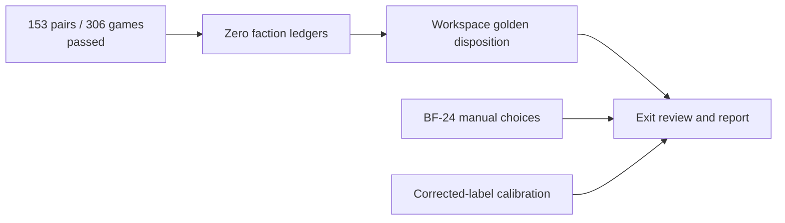

# BF-25 sampled original-18 pair campaign — 2026-10-11

Current source: wp/base-factions, HEAD a8ed02533f3b2c1cc3bb38f49b280b5ba1b7e12a plus scoped dirty work. Training remains stopped; no checkpoint or dataset overwritten.

The accepted BF-25 contract is a fixed seed sample for every unordered pair of the original 18 factions. The existing seated-soak runner now accepts `pairs`; the legacy single-faction/all entry points and default 25 seeds remain unchanged. Pair mode defaults to two seeds and cannot print the singleton exit-gate label. Fillers use the existing original-six seating list; production scope is unchanged.

All 153 unordered pairs are seated once for seed 0 and once for seed 1. Each table contains six distinct factions. The pair shifts one seat between those seeds; existing per-case RNG and full game construction are reused. The existing bounded worker pool catches case panics, errors, unfinished games, missing jobs and replay divergence, then reports failures in canonical order. Replay compares decisions, events and serialized final state.

## Actual checks

- Harness: `cargo test -j8 -p ti4-sim --example base_faction_soak -- --test-threads=8`: **3 passed, 0 failed**, exit 0. Log `out/logs/check-bf25-pair-harness-tests-fixed-20261011.log`. The initial run's mistaken test expectation for the legacy Xxcha seat failed; that expectation was corrected to seat d, without changing legacy behavior. Initial log retained.
- Campaign: `cargo run --release -j8 -p ti4-sim --example base_faction_soak -- pairs 0 2 10`: **153 pairs, 306 primary games, 0 failures**, exit 0. One replay per pair (153 additional executions) matched. Raw log `out/logs/check-bf25-original18-pairs-20261011.log` includes all pair results and progress. Fresh optimized build, one Cargo coordinator, at most 16 independent worker threads. Each game remains bounded by 50 rounds/25000 steps. The owned process could be cancelled through its command session; it completed normally.
- Independent gpt-6.1-sol source recheck passed before the operator restricted subsequent subagents to Terra/Luna. It checked complete pair enumeration, deterministic distinct seating, legacy behavior, replay/failure handling and non-exit labeling. It did not run the campaign. Implementer Luna; coordinator ran all checks.

This establishes sampled co-seating and replay identity. It does not guarantee combat between every pair in both attacker/defender roles, validate all faction decisions, or qualify the retained predictor. The zero DEFAULT faction ledgers now pass (below). BF-25 still requires workspace golden disposition, frontier exit review and milestone report. Current workspace: 4068 passed/1 failed/6 ignored, with ti4-review semantic_golden the sole failure; no fixture regeneration.

## Twelve-faction ledger result

The DEFAULT asset gate passes: **147/147 assets across the twelve, zero missing/blocked, zero mech, breakthrough or leader gaps**. Command `cargo test -j8 -p ti4-sim --example ledger -- --nocapture --test-threads=8`; final source rerun together with pair-harness tests `cargo test -j8 -p ti4-sim --example ledger --example base_faction_soak -- --nocapture --test-threads=8`: **4 tests passed**, exit 0. Logs `check-bf25-twelve-ledgers-final-20261011.log` and `check-bf25-final-harnesses-20261011.log` under out/logs. This is registry coverage, not new behavioral qualification.

Two diagnostic seams were inconsistent with the active content set. unimplemented_mechs built the obsolete base ID rather than calling the existing faction_unit resolver; it now reports the resolved active ID. leaders::unimplemented was hardcoded to PoK; it now accepts SourceSet, and all diagnostic/test callers pass their actual set. Existing PoK assertions retain the older uncovered Naalu printing. DEFAULT scope is the BF campaign contract; no claim that older PoK Naalu agent/mech gaps were implemented.

Mech regression first failed on DEFAULT (red log), then passed after resolving reprints. Its first PoK expectation mistakenly assumed Codex/Omega was in PoK; that test expectation was corrected against the actual source set (initial logs retained). Twelve-ledger checks then exposed the leader-report mismatch, fixed at the shared helper and every caller rather than suppressing the missing row. Final engine library: **2813 passed, 0 failed, 1 ignored**, exit 0 (`check-bf25-engine-ledger-helpers-20261011.log`). Engine/sim example callers compile (`check-bf25-ledger-callers-20261011.log`). Independent gpt-5.6-luna reviewed both final helpers/callers and source-sensitive assertions; no actionable finding. No gameplay rule change.

Only owned spans were formatted. Read-only whole-file format checks still report pre-existing unrelated formatting in the 27-faction soak list and the dirty faction_abilities.rs Mecatol condition; these were preserved. The subsequent workspace result and wider golden diagnosis are recorded below.
## Frozen reviewer golden diagnosis

The fresh reviewer CLI used the same committed checkpoint/map pool, seed7777, rotation2, learner temperature0.5 and 240 steps. It saved 241 raw frames (`out/logs/bf25-golden-full-diagnostic-20261011.ti4review.json`, exit0, log `check-bf25-golden-full-diagnostic-20261011.log`), without updating the frozen fixture. Independent Luna initially compared a JavaScript reconstruction of the semantic_golden.rs projection; the later exact Rust comparison below supersedes its serialization details: manifest/input identities match; 9 frames match and 232 differ. Both sessions remain in progress, same phase/round, with no engine error. Current trajectory has 288 choices/21 completed actions versus historical 302/27.

First difference frame7 is the extra typed STRATEGY_PHASE_ENDED boundary before ACTION_PHASE_BEGAN, introduced by committed aebf1ce9 to support Naalu Telepathic/Gift hooks. This lineup contains no Naalu seat; the diagnostic demonstrates generic event emission, not execution of those abilities. Frame8 is an actual decision-surface difference: distant Xxcha is offered component|trade|hacan. Committed 52066efa made Guild Ships work for either transaction party; the regression guild_ships_let_a_hacan_seat_deal_with_a_stranger covers this gate, and BF-wave-B evidence explicitly records this frozen-golden failure. Current diplomacy is disabled and the transaction counters are clear, so the offer follows the accepted predicate. This is not a defect to remove to match the old fixture.

The added option can alter later sampled play, but it does not prove that every downstream difference or small score drift is intended. A deeper decision-boundary comparison/versioned reference decision remains open. BF-wave-B.md explicitly says regeneration needs operator approval and the documented golden process; approval has not been inferred from this continuation. No historical fixture was regenerated, no passing workspace gate or BF25 milestone closure claimed. Frozen fixture SHA256 remains 1F675D4F311194C38A90EF0EA145D6C5812A7583349D0AA9D4C672106B943F1A.
## Current workspace verification

The coordinated CPU-libTorch workspace run completed with **4068 passed, 1 failed, 6 ignored**, exit 101. Command: cargo test --workspace --no-fail-fast -j8 -- --test-threads=8. Raw log: out/logs/check-base-factions-workspace-bf25-20261011.log. The only failed target remains ti4-review semantic_golden. This snapshot includes the new ground-casualty test, before the later Garv/Gunn and Naaz manual fixtures; those require separate affected-suite checks. No golden waiver, regeneration, or whole-milestone completion claim.

## Exact current-reference candidate (review only)

Root extracted digest, number, frame_projection and projection verbatim from semantic_golden.rs, changing only LiveReview.session references to a loaded ReviewSession. The scratch source and executable remain in ignored out/logs; no Cargo target, source fixture or dependency changed. Cargo dependency fingerprints identified the compatible existing review/serde_json/sha2 libraries; native Windows/libTorch search paths resolved linking. Initial scratch failures remain logged.

The exact Rust projection produces **241 frames, 9 identical and 232 different** from the frozen reference. Candidate: out/logs/bf25-current-golden-candidate-rust-20261011.json. SHA256: **79B9A9AFE0D08A95579F0C9D564866CDB6C3AAC55D87514EA145B3A6B45AFD51**. Raw verification: out/logs/check-bf25-rust-candidate-exact-20261011.log. The JavaScript candidate is NOT exactly equal despite matching frame counts; retain it only as diagnostic history. Independent Luna comparison finds 112 payload-hash differences across33 frames, caused by object-key ordering during payload serialization; all other fields agree. Aggregate9/232 equality is insufficient for exactness. No statement that a JavaScript hash reproduction was exact is supported.

The workspace identity-hook test and override-score test both passed; the historical-reference comparison alone failed. The first semantic differences are the accepted typed strategy-end event and two-way Hacan Guild Ships offer described above. Downstream sampled trajectory changes and minor numerical drift are not thereby independently qualified. Candidate availability does not grant approval to regenerate or waive the frozen golden. BF-wave-B.md requires operator approval and the documented process; the historical fixture remains untouched.

Independent gpt-5.6-luna verified final candidate projection, identities, checksum, raw workspace counts and evidence limits. Its wording finding distinguished generic strategy-end emission from actual Naalu hook execution; root corrected it. No golden acceptance/qualification follows from this documentation review.

## Bounded causal intervention (diagnostic only)

A scratch PolicyHook suppresses only seat2's component|trade|hacan answer path before delegating to its policy; the production engine and outer trace still see the real offered option. It runs the same 240-step inputs with CPU libTorch/OMP1/MKL1. Source: out/logs/bf25-intervention-no-hacan-trade-reviewed-20261011.rs; raw/projected artifacts: bf25-golden-intervention-no-hacan-trade-20261011.ti4review.json and bf25-intervention-no-hacan-trade-candidate-20261011.json in out/logs. Build/run logs check-bf25-intervention-build-20261011.log and check-bf25-intervention-run-20261011.log; exit0, 241frames/288decisions/22actions, in-progress round1/action, zero frame errors. This is a synthetic intervention, not a legal production rule or qualification run.

The intervention changes sequence11 from a Hacan transaction to end_turn. Removing only that deliberately forced answer yields a 17-decision prefix aligned with the frozen reference by player/prompt/path/chosen (including the expedition and five ingress answers). The next divergence is another current end-turn question at seat5. This does not restore the historical trajectory; the frozen reference has302decisions/27actions. Aggregate outcomes cannot substitute for decision alignment.

Root also verified option surfaces differ before chosen identity diverges: sequence6 has the Hacan offer; sequence7 replaces activation system18 with112 while keeping chosen114. Earlier informal agent wording that option IDs matched throughout the eleven-decision chosen prefix was incorrect; the exact prefix audit supersedes it. Commit1845b263 establishes the accepted Thunder's Edge Mecatol112 board contract, but the immediate captured-map normalization in crates/ti4-sim/src/maps.rs is a PRE-EXISTING UNCOMMITTED hunk using seating::mecatol_for. Do not attribute that hunk to a committed implementation or edit it silently. The map input identity remains unchanged while effective board interpretation changes under DEFAULT sources; a source-sensitive placement regression is the bounded next check.

No frozen fixture refresh is proposed as an automatic fix. The accepted first surface changes and controlled intervention explain part of the divergence, while downstream trajectory/numerical qualification and the documented operator-approved reference disposition remain open.

## Source-sensitive captured-map regression — 2026-10-12

Luna authored `maps::tests::captured_mecatol_is_normalized_per_scope_without_mutating_the_pool`; root independently reviewed its exact source and the pre-existing normalization hunk against seating::mecatol_for and the accepted1845b263 Thunder's Edge contract. Same captured18 coordinate/seed/home inputs yield18 underPOK and112 underDEFAULT. Neither pool.draw nor caller-owned home array changes. No normalization producer edit or commit attribution is implied.

Focused Cargo-j8/testthreads8:1passed/0failed, exit0, out/logs/check-bf25-map-scope-20261012.log. Full ti4-sim lib:52passed/0failed/1ignored, exit0, out/logs/check-bf25-sim-lib-20261012.log. CPU libTorch absolute path, OMP1/MKL1. This closes the source-scope regression check; historical reviewer reference disposition remains open.

Independent Luna bounded first-divergence audit: strategy draft ordinals0–5 exactly match the frozen projection. Atordinal6 the accepted Hacan action offer appears; common-option six-decimal scores differ by 1–4 millionths, with the same rounded probabilities. Ordinal7 replaces option18 with112 at identical score/probability and chosen114. Ordinals8–10 retain chosen/player/prompt/path and option IDs. First chosen identity divergence ordinal11 follows the new end-turn Hacan offer. Existing no-Hacan intervention traces ORIGINAL outer option scores; they do not prove filtered batched score equality. A fixed-vector batch-size diagnostic and fresh repeat projection are the next bounded checks, with no fixture refresh permission inferred.
